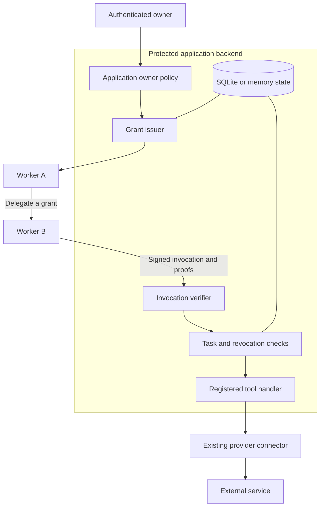

# Architecture

## Deployment boundary

Capvine has a client library and a protected authority implementation. They can be embedded in existing applications; no Farming Labs service is required.

A client application, worker runtime, or scoped sidecar holds the recipient's signing key. In an agent integration, model output requests an operation; trusted runtime code signs the invocation. The authority signing key, state store, policy code, connector credentials, and operation implementations stay outside the client's control. Neither an in-process example nor separate processes under one OS user provide a sandbox for hostile code. See the [network example](../examples/network/README.md) for real HTTP dispatch and the [integration guide](integration.md) for application wiring.

The `task` field is a lifecycle context, not an agent-specific requirement. Applications can use it for jobs or workflows while preserving the current profile's exact restrictions. Roles or ACLs may inform the issuance policy; Capvine verifies the resulting grant before resource dispatch. Database-native authorization and provider authentication remain separate integration concerns.

## Capability profile

This prototype uses ucanto's installed delegation format, not a claim of compatibility with every UCAN specification version. Dependencies are pinned in `package-lock.json`.

Each grant carries exactly one `capvine/invoke` capability:

| Field        | Meaning                                               |
| ------------ | ----------------------------------------------------- |
| `with`       | An exact `urn:capvine:resource:...` identifier        |
| `nb.action`  | The registered operation, such as `github/issue.read` |
| `nb.task`    | The task whose lifecycle governs the invocation       |
| `nb.service` | The receiving authority's `did:key` identity          |
| `audience`   | The identity allowed to use or delegate this grant    |
| `expiration` | Finite expiry in Unix seconds                         |

Operation, resource, task, and service must remain equal through delegation. A child can shorten its lifetime and change its recipient. Wildcards, groups of resources, multi-parent authorization, budget splitting, and caller-selected arguments are outside this initial profile.

The profile permits one embedded parent proof at each step, at most eight nodes including the invocation, and an archive of at most 64 KiB. This bounds the supported proof shape; it is not a general UCAN validator.

## Grant issuance

1. The application authenticates the owner and resolves the resource through its own trusted setup flow.
2. Resources and tasks are registered in the state store. Duplicate identifiers are rejected; resource identifiers cannot be retargeted through the store API.
3. `authority.issue` checks the task is active, resource and task ownership agree, and the operation supports that resource kind.
4. The required `authorizeGrant` callback decides whether the authenticated actor may issue the requested permission.
5. ucanto signs the grant for the worker's public identity. The root grant's CID is stored locally.

The `actor` argument is application context, not independently authenticated by Capvine. Never populate it directly from an untrusted request body. Possession of the authority object or its backing store is privileged.

## Delegation

The current recipient signs a child grant containing its parent as proof. The SDK exposes no action or resource override when delegating. Expiry can be reduced. These client checks are convenience only: the server repeats the relevant enforcement for arbitrary signed requests.

Delegation is local to the worker and does not require another owner interaction. Child grants need not be pre-registered in the database. Their proofs travel with the invocation. The store records root grants; it does not claim to enumerate every child grant created offline.

The application remains responsible for provisioning clients and handing each grant to the correct identity. An optional MCP adapter will need authenticated worker/task bindings. Multiple workers using the same MCP identity cannot be reliably distinguished from model-supplied names alone.

## Invocation

1. The client signs an invocation to the service, embedding its grant chain and a short invocation lifetime.
2. The transport sends an archive of bytes. The authority decodes it; `decodeGrant` alone does not authenticate a grant.
3. Preflight rejects unsupported profiles, missing proofs, expiry expansion, a wrong receiving service, and unknown root grants.
4. ucanto checks signatures, proof-recipient alignment, temporal validity, and the capability profile's derivation rules. Only the configured service can originate accepted root authority.
5. The authorization callback checks revocations on the validated path. The dispatcher checks current task state, resource ownership, operation kind, and revocations again before dispatch.
6. The dispatcher writes an authorization audit event and calls the registered handler with the resource binding from server storage.

The handler should use only the connection and target derived from that verified resource. GitHub and other providers see their ordinary credentials; they do not need UCAN support.

`allowed` in the audit log means authorization passed and dispatch was about to begin, not that an external operation committed. Handler failures receive a subsequent `failed` event. Audit records currently contain invocation IDs and outcomes, not full proof archives or sensitive tool inputs/outputs.

## Persistence and revocation

The SQLite store uses an append-only resource/root-grant registry, task records whose active state can be ended, a revocation set, and audit records. It is a small single-server adapter with no schema migration or multi-region coordination layer yet.

Revoking any known grant CID invalidates invocations whose chain depends on that grant. Revoking a parent does not require discovering all its descendants. Another independent grant remains independently usable.

Task termination disables all grants bound to that task. Neither operation can undo work already dispatched. Restore state and the same authority identity together after a restart. A fresh empty store will reject old root grants.

## HTTP transport

The Node `./http` entry exports `createHttpHandler`, `createHttpTransport`, and `HttpTransportError`. Mount the handler on a protected service; it accepts only `POST /invoke` with `application/vnd.ipld.car`. It serves no issuance, registration, revocation, or other administration routes. Pass `authority.execute` as its executor.

Requests are bounded to 64 KiB and tool result payloads to 1 MiB. The handler limits admitted concurrency to 16 and returns `429` when full. It rejects browser Origin headers, bounds body-read time, and returns generic errors instead of internal exception details. An authorization failure maps to `403` and then `PermissionDenied` on the client.

The client requires HTTPS except on loopback, refuses redirects, bounds response reading, and has a default ten-second request timeout. It does not retry. A timeout is not proof that the handler did not run. TLS termination, host/network isolation, per-principal rate limits, execution cancellation/deadlines, and owner authentication remain deployment responsibilities.

The demo keeps its control channel private to the supervisor and authority through parent-process IPC. Its authority identity and SQLite database are temporary. A persistent service needs durable identity/state and a separately authenticated administration surface. The synchronous SQLite adapter is a single-server design, not coordinated multi-replica state.

## Existing components and Capvine code

ucanto supplies signing, proof representation, serialization, and proof validation. Capvine supplies this constrained permission profile, owner-policy integration, resource and task binding, server dispatch, and lifecycle persistence. The caller supplies authentication, runtime isolation, transport deployment, secret storage, and provider connectors.
