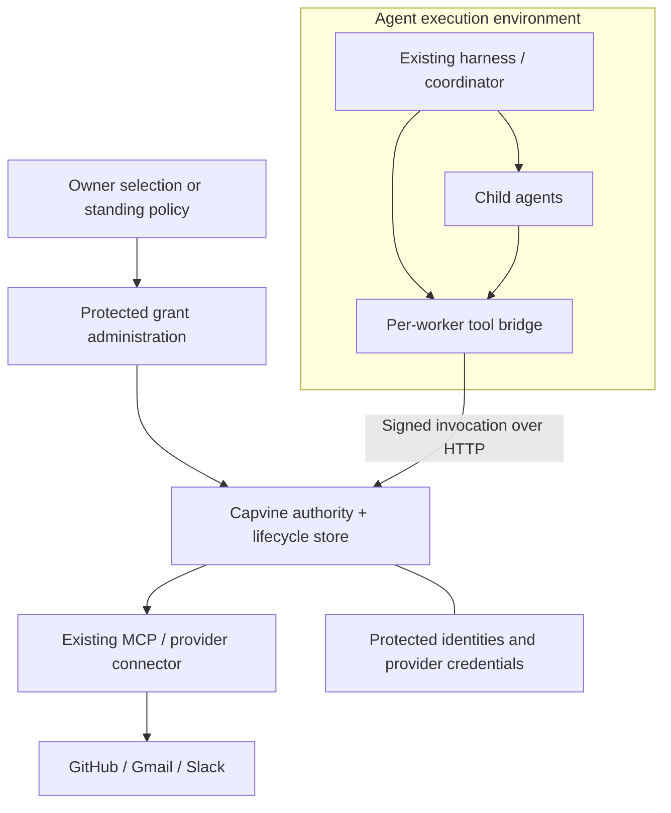

# Adding Capvine to an existing agent project

Capvine belongs between a tool call and the code that uses the provider credential. Your existing runtime still runs the model, schedules work, and spawns agents. Your connector still speaks GitHub, Gmail, or Slack. Capvine checks whether this worker may invoke this operation on this registered resource for this task.

The first target user is a developer who controls the application's tool handlers and backend. Adding a package cannot restrict an unrelated application that still has unrestricted credentials or a logged-in browser.

## A complete task

Suppose the owner selects issues 42, 43, and 44 and starts “summarize these issues.”

| Step | Who acts                                 | What happens                                                                                             |
| ---- | ---------------------------------------- | -------------------------------------------------------------------------------------------------------- |
| 1    | Authenticated owner + application policy | Resolve the selected issues into registered resources and create a task.                                 |
| 2    | Runtime                                  | Create coordinator A's identity; keep its private key outside model text.                                |
| 3    | Authority                                | Issue three exact read grants to A, one per issue.                                                       |
| 4    | Runtime                                  | Spawn B, C, and D with distinct identities.                                                              |
| 5    | A's delegation code                      | Delegate issue 42 to B, 43 to C, and 44 to D, shortening grant lifetimes.                                |
| 6    | Each worker's tool bridge                | Sign a request with its identity and assigned grant.                                                     |
| 7    | Authority                                | Verify the chain, resource/action/task/service restrictions, expiry, and current revocations/task state. |
| 8    | Protected handler                        | Read the bound issue through the existing connector.                                                     |
| 9    | Runtime / owner policy                   | End the task or revoke a grant when access is no longer needed.                                          |

Three workers are a demonstration choice. One worker needs one grant; a coordinator is optional. Spawning an agent does not create permission. A runtime can start a worker with no grants and attach one after policy allows it.

## How does it choose the reference?

The model can propose “read issue 42.” That proposal is input, not proof of permission. The application resolves the resource within an authorized connection and applies its owner policy. The authority then signs a grant for a particular worker identity.

Here, the owner's selected issues determine the allowed resources before workers start. A standing policy can automate issuance for an allowed set, with the same server checks. Requests outside that set need a new policy decision or owner approval. A classification model can suggest a selection; declaring its own choice safe does not establish owner authority.

Each read and each delegation within an existing grant does **not** need another human click. The verifier checks automatically. New authority requires a new authorized grant.

Using the room metaphor: the owner approves three room keys, the coordinator passes a particular key to each helper, and the lock checks that key on every use. Changing a label on the key cannot change which room it opens.

## The code boundary

These snippets use current Capvine APIs and show integration points, not a complete application. The package is still private on npm; run the repository examples or use a local checkout rather than assuming an npm release exists.

The protected backend serves invocation on its worker-facing HTTP listener:

```ts
import { createServer } from "node:http";
import { createHttpHandler } from "@farming-labs/capvine/http";

const server = createServer(
  { headersTimeout: 5_000, requestTimeout: 10_000 },
  createHttpHandler({ execute: authority.execute }),
);
server.listen(8080, "127.0.0.1");
```

`authority` comes from `createAuthority`, with operations, resource records, a store, and an owner policy as shown in the [working authority process](../examples/network/authority.ts). Keep issuance, resource registration, revocation, and task administration on a separate authenticated control surface. The example uses private parent-process IPC.

The worker runtime receives the expected service identity through trusted configuration, and the grant through provisioning:

```ts
import { createClient } from "@farming-labs/capvine";
import { createHttpTransport } from "@farming-labs/capvine/http";

const client = createClient({
  signer: workerIdentity,
  service: expectedServiceIdentity,
  transport: createHttpTransport({
    url: "http://127.0.0.1:8080/invoke",
  }),
});

const readAssignedIssue = () => client.invoke(assignedGrant);
```

Register `readAssignedIssue` as a tool using the existing framework. The callback closes over the worker's grant. The model supplies neither an account token nor an arbitrary issue ID. For several permitted resources, trusted code can select from a map of that worker's actual grants; missing entries fail instead of falling back to a master credential.

When A spawns a child, bind the returned child identity to a delegated grant:

```ts
const childGrant = await coordinatorClient.delegate({
  grant: parentGrant,
  audience: childPublicIdentity,
  expiresAt: new Date(Date.now() + 5 * 60_000),
});
```

The parent must have at least that remaining lifetime. The child invokes using its own signer. Send grants with `encodeGrant` / `decodeGrant`; decoding is not authorization. The authority verifies at invocation time.

## Where it fits in Simon's Mac mini setup



This adds tool authorization alongside his harness and gateway. An existing MCP connector can sit behind a registered handler if the handler pins the verified target and does not expose an unrestricted connector call to the agent. A reusable MCP adapter is a roadmap item, not implemented here.

Docker still restricts code execution separately. The agent must not mount authority state or credentials, control its process/container, or have a second unrestricted service path. A browser logged into the owner's bank account remains another source of authority; this HTTP adapter cannot constrain its clicks. Residential routing changes where traffic originates, not what is authorized.

## Other Farming Labs integration points

These are proposed wiring points, not shipped or tested integrations:

- **[agent-unit](https://github.com/farming-labs/agent-unit):** keep its runtime adapters, run persistence, and pause/resume. Bind grants in application tool implementations. Every new external dispatch after retry or resume must verify again; a saved workflow must not restore an old authorization decision as current authority.
- **[modebox](https://github.com/farming-labs/modebox):** its `hostFunctions` seam can expose `issues.readAssigned: () => client.invoke(assignedGrant)`. Keep the signer and client in trusted host code; guest code gets only the narrow callback. Any new external request after resume must re-enter verification. Returning an already saved read result is different; revocation cannot erase data already returned.

In both cases, approval may establish a grant or approve a future exact action. Approval does not replace server enforcement or deployment isolation.

## What scales now?

| Dimension                   | Current behavior                                                                                      | Next engineering step                                                                                           |
| --------------------------- | ----------------------------------------------------------------------------------------------------- | --------------------------------------------------------------------------------------------------------------- |
| More agents                 | Independent identities/grants; fan-out does not deepen each chain. Demo runs 1–8 workers.             | Measure realistic load and denial traffic before claiming capacity.                                             |
| Deeper delegation           | One parent per link; at most eight nodes including the invocation.                                    | Review and benchmark a broader proof profile if needed.                                                         |
| More services               | Register operations and immutable resources around existing connectors.                               | Provider-specific target validation and least-privilege credentials.                                            |
| Persistence                 | SQLite stores roots, resources, tasks, revocations, audit. Keys live elsewhere.                       | Migrations, backups, key lifecycle, retention, administration.                                                  |
| HTTP                        | 64 KiB request archives, 1 MiB result payloads, 16 admitted requests per handler, `429` backpressure. | Hosted TLS, per-principal rate limits, execution deadlines, load testing, monitoring.                           |
| Multiple authority replicas | Not supported as a coordinated deployment; the store API is synchronous/local.                        | Async durable store, shared lifecycle state with defined consistency, shared root trust, replica failure tests. |
| Writes and money            | Outside this repeatable-read prototype.                                                               | Exact approved parameters, replay handling, atomic limits, provider idempotency.                                |

The client does not retry automatically. A timeout does not prove a handler did not run. See the [roadmap](roadmap.md) for the implementation order.
