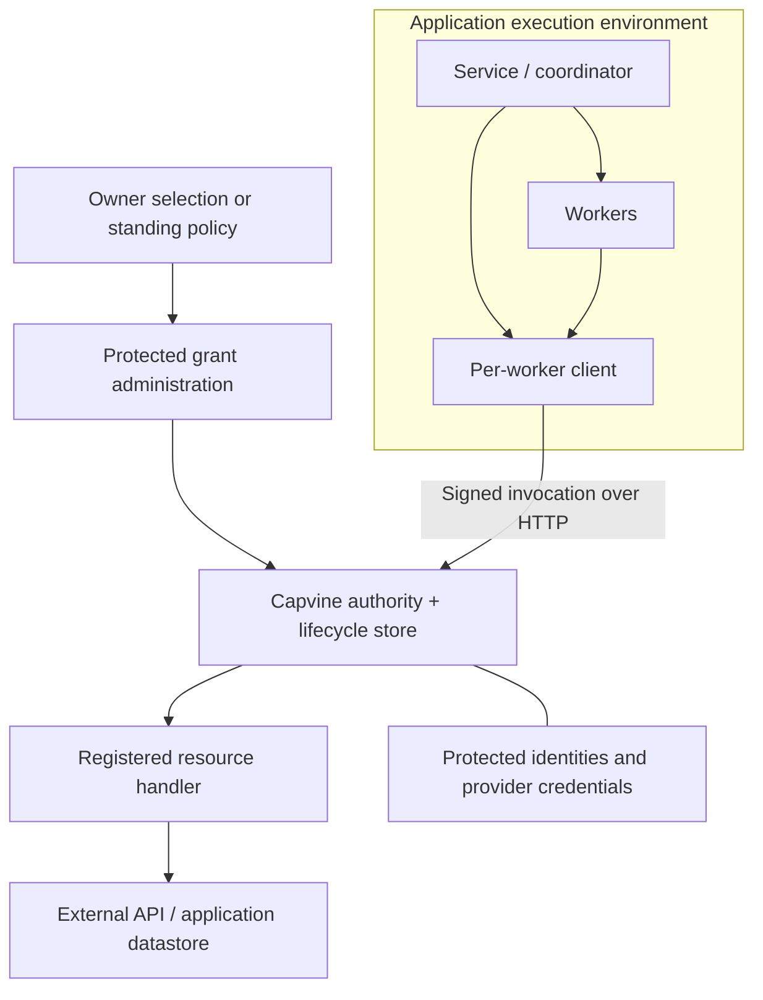

# Integrating Capvine into applications and services

Capvine sits between a client request and a protected resource handler. The application schedules work and manages identities; the handler connects to the underlying service or datastore. Capvine verifies whether the caller may invoke the requested operation on the registered resource within an active authorization context.

The current API calls that context a `task`: a lifecycle record that can represent a job, workflow, or bounded unit of work. It does not require an LLM or agent runtime. Clients must still follow the prototype's exact resource/action/task/service profile.

Integration requires control over the resource handler and access paths. An application with separate unrestricted credentials can bypass a capability-aware API.

## A complete task

The network example creates a job to read issues 42, 43, and 44 using a coordinator and three workers.

| Step | Who acts                                 | What happens                                                                                             |
| ---- | ---------------------------------------- | -------------------------------------------------------------------------------------------------------- |
| 1    | Authenticated owner + application policy | Resolve the selected issues into registered resources and create a task.                                 |
| 2    | Runtime                                  | Create coordinator A's identity and protect its private key.                                             |
| 3    | Authority                                | Issue three exact read grants to A, one per issue.                                                       |
| 4    | Runtime                                  | Spawn B, C, and D with distinct identities.                                                              |
| 5    | A's delegation code                      | Delegate issue 42 to B, 43 to C, and 44 to D, shortening grant lifetimes.                                |
| 6    | Each worker's client                     | Sign a request with its identity and assigned grant.                                                     |
| 7    | Authority                                | Verify the chain, resource/action/task/service restrictions, expiry, and current revocations/task state. |
| 8    | Protected handler                        | Read the bound issue through the existing connector.                                                     |
| 9    | Runtime / owner policy                   | End the task or revoke a grant when access is no longer needed.                                          |

Three workers are a demonstration choice. One worker needs one grant; a coordinator is optional. Starting a process does not create permission. A runtime can provision a worker with no grants and assign one after policy allows it.

## Resource selection and issuance policy

The client requests access to a resource. The application resolves that resource within an authorized connection and applies its issuance policy, which can consult existing roles or ACLs. The authority signs a grant for the selected recipient only if that policy permits it. A client-provided resource name or claimed role is not proof of authorization.

In the example, trusted setup selects allowed issues before workers start. A standing policy can automate issuance for an allowed set. Requests outside that set require a new authorized decision. An agent or classification model may propose a selection; application policy must still authorize it.

Reads and delegation within an existing grant do not require repeated human approval. The verifier checks each invocation automatically. Additional authority requires a new authorized grant. Resource discovery and an authenticated grant-request API are application responsibilities; this prototype does not implement them.

## The code boundary

These snippets use current Capvine APIs and show integration points, not a complete application. The package is still private on npm; run the repository examples or use a local checkout rather than assuming an npm release exists.

The protected backend serves invocation on its worker-facing HTTP listener:

```ts
import { createServer } from "node:http";
import { createHttpHandler } from "@farming-labs/capvine/http";

const server = createServer(
  { headersTimeout: 5_000, requestTimeout: 10_000 },
  createHttpHandler({ execute: authority.execute }),
);
server.listen(8080, "127.0.0.1");
```

`authority` comes from `createAuthority`, with operations, resource records, a store, and an owner policy as shown in the [working authority process](../examples/network/authority.ts). Keep issuance, resource registration, revocation, and task administration on a separate authenticated control surface. The example uses private parent-process IPC.

The worker runtime receives the expected service identity through trusted configuration, and the grant through provisioning:

```ts
import { createClient } from "@farming-labs/capvine";
import { createHttpTransport } from "@farming-labs/capvine/http";

const client = createClient({
  signer: workerIdentity,
  service: expectedServiceIdentity,
  transport: createHttpTransport({
    url: "http://127.0.0.1:8080/invoke",
  }),
});

const readAssignedIssue = () => client.invoke(assignedGrant);
```

Use `readAssignedIssue` in a job handler, service workflow, or agent tool registration. The callback closes over the worker's grant and accepts no target override. For several permitted resources, select from a map of that worker's actual grants; missing entries must fail instead of falling back to a broader credential.

When A spawns a child, bind the returned child identity to a delegated grant:

```ts
const childGrant = await coordinatorClient.delegate({
  grant: parentGrant,
  audience: childPublicIdentity,
  expiresAt: new Date(Date.now() + 5 * 60_000),
});
```

The parent must have at least that remaining lifetime. The child invokes using its own signer. Send grants with `encodeGrant` / `decodeGrant`; decoding is not authorization. The authority verifies at invocation time.

## Deployment boundary



The authority verifies the grant and loads the immutable resource binding before calling the handler. The handler selects credentials and executes against the bound target. The client receives the operation result, not an upstream credential. The example demonstrates this with one simulated provider connection; multi-account credential management remains an application integration.

OS and network isolation are separate deployment responsibilities. Clients must not be able to modify authority state, control its process, read protected credentials, or bypass verification through another privileged connection. The example's separate processes run under the same OS user and do not establish hostile-code containment.

## Resource and runtime adapters

The following are integration patterns, not shipped or tested adapters. The next milestone combines filesystem and PostgreSQL resource adapters in one configurable server, reusing the existing authority and HTTP transport. Its layers and acceptance criteria are tracked in [issue #3](https://github.com/farming-labs/capvine/issues/3) and the [roadmap](roadmap.md#1-resource-server-with-filesystem-and-postgresql-adapters).

- **Filesystem operations:** register a bounded read of one regular text file. The adapter owns safe target resolution, file-identity semantics, and limits while reading. The initial scope does not accept caller-selected paths or directory-wide authority. Tests must address path/link escapes and replacement races within the supported deployment model.
- **Database-backed operations:** register a defined operation such as reading one invoice. After verification, the handler queries the bound record using a restricted database connection. Database roles and row permissions can provide additional enforcement. This does not authorize arbitrary SQL or make the database understand capability proofs.
- **Background jobs and service workflows:** provision separate client identities and bind grants to the job context. New external calls after retry or resume must verify again; saved workflow state must not turn an old authorization decision into current authority.
- **Sandbox host functions:** keep the signer and client in trusted host code and expose only a callback bound to the assigned grant. A guest must not receive an unrestricted resource handler or provider credential.
- **Agent tools and MCP:** register a scoped callback or connector operation and authenticate worker/task sessions. Model-supplied names are not identity. A reusable MCP adapter remains planned.

Reusing a saved read result is different from making a new request; revocation cannot erase data already returned. Approval does not replace server enforcement or deployment isolation.

The PostgreSQL resource adapter would protect application data. A PostgreSQL implementation of `StateStore` would instead persist Capvine's grants and lifecycle state. These are separate integrations; the first resource-server milestone can retain SQLite for permission state. Validated configuration and trusted local bootstrap are planned for server setup; an invocation endpoint does not provide an authenticated remote administration API.

## What scales now?

| Dimension                   | Current behavior                                                                                      | Next engineering step                                                                                           |
| --------------------------- | ----------------------------------------------------------------------------------------------------- | --------------------------------------------------------------------------------------------------------------- |
| More clients                | Independent identities/grants; fan-out does not deepen each chain. Demo runs 1–8 workers.             | Measure realistic load and denial traffic before claiming capacity.                                             |
| Deeper delegation           | One parent per link; at most eight nodes including the invocation.                                    | Review and benchmark a broader proof profile if needed.                                                         |
| More services               | Register operations and immutable resources around existing connectors.                               | Provider-specific target validation and least-privilege credentials.                                            |
| Persistence                 | SQLite stores roots, resources, tasks, revocations, audit. Keys live elsewhere.                       | Migrations, backups, key lifecycle, retention, administration.                                                  |
| HTTP                        | 64 KiB request archives, 1 MiB result payloads, 16 admitted requests per handler, `429` backpressure. | Hosted TLS, per-principal rate limits, execution deadlines, load testing, monitoring.                           |
| Multiple authority replicas | Not supported as a coordinated deployment; the store API is synchronous/local.                        | Async durable store, shared lifecycle state with defined consistency, shared root trust, replica failure tests. |
| Write operations            | Outside this repeatable-read prototype.                                                               | Exact approved parameters, replay handling, atomic limits, provider idempotency.                                |

The client does not retry automatically. A timeout does not prove a handler did not run. See the [roadmap](roadmap.md) for the implementation order.
