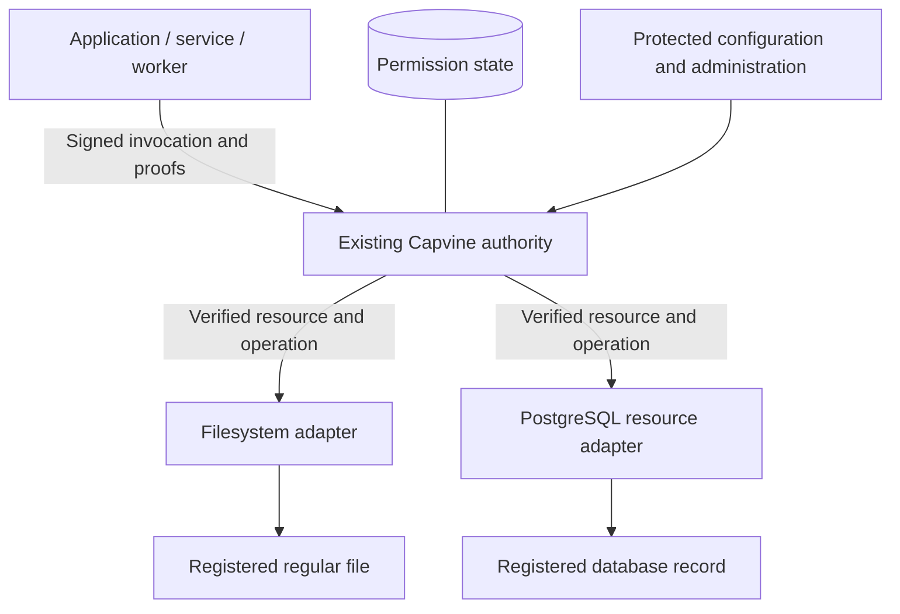

# Roadmap

Capvine is an OSS authorization library for developers who control application resource handlers and access paths. The core supports delegated permissions for services, workers, and applications; agent tools are one integration. Resource adapters connect verified requests to external APIs or application datastores. A managed service can operate the same enforcement engine later.

This is an implementation sequence, not a delivery-date commitment. Persistent service composition, filesystem/PostgreSQL adapters, GitHub reads, and a provisioned MCP bridge are implemented. The [configuration-file server and combined real-resource example](server-command.md) complete the resource-server milestone in [issue #3](https://github.com/farming-labs/capvine/issues/3). Reference-container isolation and release preparation are verified in CI. External review, production-host validation, and publication gates remain open in [issue #16](https://github.com/farming-labs/capvine/issues/16).

## 0. Runnable proof of the boundary — implemented

- [x] A TypeScript package built on ucanto.
- [x] Exact operation/resource/task/service binding.
- [x] Recipient-bound delegation with shorter lifetimes.
- [x] Server verification of serialized requests independent of client checks.
- [x] Parent/child revocation and task termination.
- [x] Memory and SQLite state with restart tests.
- [x] An offline GitHub-shaped example and adversarial authorization tests.
- [x] A bounded Node HTTP handler and client transport.
- [x] Separate authority, coordinator, and workers with a simulated credentialed provider.
- [x] Parallel reads, raw escalation attempts, independent-root revocation, and task-end checks across HTTP.
- [x] A [local delegation playground](../examples/delegation-playground/README.md) with real separate-process signing, raw forbidden requests, provider counters, revocation, and task termination. Disposable fixtures only; production owner approval UI remains open.

**Evidence:** `npm run check`, `npm run example`, and `npm run example:network -- --workers 3`. The network scenario is an automated test too. This establishes an application permission path, not OS isolation or production readiness.

## 1. Resource server with filesystem and PostgreSQL adapters — implemented

### Foundation and integration checklist

These prerequisites remain visible independently of the adapter work:

- [x] Persistent authority identity and authenticated single-owner operator administration ([issue #5](https://github.com/farming-labs/capvine/issues/5)); verified by `test/service.test.ts` and `npm run example:service`.
- [x] Transactional state schema versioning, service/owner binding, restart checks, and bounded audit inspection.
- [x] Live read-only GitHub connector with actual provider target validation; `test/github.test.ts` and `npm run example:github`.
- [x] MCP integration bound to a provisioned worker identity, task, and grants; `test/mcp.test.ts` and `npm run example:mcp`.
- [x] Credential/network isolation checks for the [constrained container reference deployment](../examples/isolation/README.md), executed in Linux CI. Production-host and macOS desktop isolation remain separate work.
- [x] Wire/version policy, package surface inspection, and fail-closed storage tests; see [release preparation](release-readiness.md).
- [ ] External API review with adopters and approval of a supported release.
- [ ] Independent security review and explicit publication approval.
- [ ] npm trusted publishing and release automation.

The first two items provide a local service foundation, not production readiness. The filesystem and PostgreSQL adapters are implemented; the configuration-file application is implemented. External review and publication gates cannot be satisfied by internal test results.

**Delivered:** the adapter lifecycle contract, protected server composition, and [filesystem/PostgreSQL readers](resources.md), verified by `test/filesystem.test.ts` and real-database `test/postgres.test.ts`. The [server command](server-command.md) and `npm run example:resources` complete the combined workflow, including separate client/server processes and restart persistence.

One server reads a registered text file and a registered PostgreSQL record through the same `client.invoke(grant)` flow. It reuses the authority, capability profile, resource registry, HTTP transport, and lifecycle checks. No agent runtime is required. `task` remains the authorization context for a job or workflow.

These layers were delivered in focused PRs linked from [issue #3](https://github.com/farming-labs/capvine/issues/3):

| Layer                                  | Required work                                                                                                                                                                                                                                                                      | Completion evidence                                                                                                                                                |
| -------------------------------------- | ---------------------------------------------------------------------------------------------------------------------------------------------------------------------------------------------------------------------------------------------------------------------------------- | ------------------------------------------------------------------------------------------------------------------------------------------------------------------ |
| Adapter contract and resource bindings | Build on `registerOperation` and `execute(resource)`. Validate adapter configuration, supported kinds/actions, target bindings, and protected connection references. Define initialization and cleanup.                                                                            | Invalid configuration, duplicate registration, and wrong-kind dispatch fail closed; proof verification remains before adapter execution.                           |
| Filesystem resource adapter            | Read bounded UTF-8 content from explicitly registered regular files. Define platform and file-identity semantics and confinement against traversal, links, and replacement races.                                                                                                  | Real filesystem tests cover allowed reads, unregistered targets, link/path escapes, replacement behavior, unsupported file types, and size limits.                 |
| PostgreSQL resource adapter            | Use a protected pool and restricted database role for a predefined parameterized read, with fixed record/tenant binding and result projection. Bound results and execution time.                                                                                                   | Tests against a real ephemeral database establish the actual queried record and reject cross-record, cross-tenant, cross-connection, and write attempts.           |
| Server composition and administration  | Add validated startup/configuration, persistent authority identity and state, adapter initialization, the existing invocation route, and graceful shutdown. Keep local bootstrap administration separate; authenticate and authorize any remote administration before enabling it. | Restart retains revocations and task state; clients cannot mint root grants, retarget resources, or obtain protected credentials through the invocation interface. |
| Combined example and deployment guide  | Run ordinary clients against both adapters through one authority, with temporary file fixtures and ephemeral PostgreSQL. Document secret custody, supported limits, deployment isolation, and adapter responsibilities.                                                            | CI exercises both real resources, delegation, independent grants, revocation, task end, and restart.                                                               |

**Storage distinction:** SQLite can continue storing Capvine's grants, resources, tasks, revocations, and audit events. PostgreSQL as a protected application resource is independent of PostgreSQL as a future permission-state backend; the latter is not required for this milestone.

**Exit criteria:** the same client API reads both resources with separate grants. Changes to resource/action/task/identity, invalid proofs, expiry, and revocation reject before resource-handler execution. Adapter tests also verify the actual file opened and database record queried; a successful proof check alone is insufficient. The authority identity and lifecycle state survive restart without resetting permissions.

**Scope:** exact read operations with bounded JSON-compatible results. Directory trees, wildcards, caller-selected paths, arbitrary SQL, writes, binary streaming, native database authorization extensions, and OS sandboxing need separate designs. The adapter contract does not replace server verification or database/OS access controls.

## 2. External-service connectors and application integrations

The [GitHub connector and provisioned MCP bridge](connectors.md) are implemented. The live smoke example uses public data, and the MCP example launches a separate stdio worker. The [direct account manager and Gmail adapter](accounts.md), [local browser account console](account-console.md), and [saved workflow approvals](workflow-approvals.md) are implemented. The console adds single-owner login, session-bound callbacks, persistent listings, disconnect, and reconnect with fresh IDs. The local OAuth/OIDC fixture checks code exchange, encrypted persistence, refresh rotation, provider identity binding, approval reuse, delegation, restart, and disabling dependent grants. A session-bound Gmail console screen now supports message selection, explicit read approval, delegation, forbidden signed requests, and revocation. A configured local Google smoke test verified consent, refresh, delegated reads, restart, parent revocation, and workflow disabling. Provider-consent revocation validation, production isolation, and remote multi-tenant MCP authentication remain open. Select the connection and stable provider object identity through trusted administration. Validate the actual target where API routes use mutable names and keep upstream credentials narrowly scoped.

The [worker provisioning API and CLI](workers.md) provide private assignments, separate-process execution, and proof renewal without changing a running worker's binding. The real-file MCP example verifies reuse of a saved approval after service restart and disabling the workflow. The [reusable owner workflow console](workflow-console.md) implements fixed configured choices, persistent approvals, separate worker provisioning, automatic renewal, and disable through a protected mapping from each worker to its saved approval ([issue #30](https://github.com/farming-labs/capvine/issues/30)).

Provider fixture tests now cover revoking an unexpired token, persistent reconnect-required status, and a fresh authenticated console connection/approval without reactivating old bindings. Live Google consent revocation remains unverified; a temporary provider failure must not be mistaken for revoked consent. Additional private providers still need their own identity, scope, credential-lifecycle, and target-binding integrations.

The [Slack account provider and message adapter](slack.md) implement OAuth v2 PKCE, rotating user tokens, stable workspace/user binding, and exact conversation/message reads through the existing verifier and worker APIs. `test/slack.test.ts` and `npm run example:slack` verify an HTTP fixture, encrypted credentials, rotation/restart, separate-process MCP reads, raw escalation rejection, and revocation. Live Slack consent and workspace-policy validation remain open; there is no Slack message-selection browser screen.

Integrate with application workflows and background jobs, then extract reusable runtime adapters from demonstrated lifecycle needs. Existing roles or ACLs may inform grant issuance. Optional agent-tool and MCP adapters use the same verifier rather than creating another permission path.

**Deliverables:** authenticated account/resource setup, client identity provisioning, serialized grant assignment, workflow binding, child delegation, and verification on new calls after resume/retry. MCP sessions require authenticated worker/task bindings rather than model-supplied names.

**Exit criteria:** a real application workflow succeeds; nested calls cannot expand authority; jobs cannot reuse another job's authenticated session; revoked grants fail after workflow restart; direct and adapted calls enforce the same rules. Document upstream permissions, target validation, and service limits.

## 3. An OSS release with a supported deployment

The [release preparation](release-readiness.md) defines the supported ucanto format/version, package surface checks, dependency policy, and publication gates. Schema versioning, identity backup/rotation limits, bounded audit inspection, and fail-closed storage behavior are documented and tested. CI installs the packed artifact into a fresh consumer and checks its runtime and type exports and installed CLI.

**Remaining work:** API review with application developers, independent security review, validation on the intended production host, explicit release approval, and npm ownership and trusted-publishing setup. Track these gates in [issue #16](https://github.com/farming-labs/capvine/issues/16); no publishing workflow is enabled.

**Exit criteria:** independent security review of the profile, verifier integration, and stated deployment boundary; integration/failure tests in that deployment; explicit maintainer approval for publication. The source remains public and MIT licensed while the package is private.

## 4. Scale and broader authority — separate designs

For multiple authority replicas, introduce an async storage contract and shared durable implementation with explicit consistency for revocations/tasks. Add tenant separation, per-principal rate limits, load measurements, and fault tests. The SQLite demo is not a horizontally scalable service.

For writes, bind authorization to exact parameters and implement replay handling, atomic consumption or budgets, concurrency control, and provider idempotency/reconciliation. A timeout must not cause a duplicate side effect. Signatures alone do not provide transaction semantics.

Resource groups, wildcard attenuation, multi-parent grants, budget splitting, and a full delegation explorer need separate semantics and tests. Offline child grants are not currently exhaustively indexed.

**Exit criteria:** each feature's invariants hold under concurrency, retries, storage failures, and revocation races. High-stakes actions are a new supported scope, not a toggle on the read example.

## 5. Optional managed offering

Operate the same OSS verifier with hosted storage, tenant provisioning, identity custody, administration, audit search, monitoring, upgrades, and availability commitments. Managed operations must not become the only place permission enforcement works.

**Exit criteria:** demand from OSS adopters, a supported production boundary, tested tenant isolation/recovery, and clear ownership of keys, data export, and incident response.

## Release validation tools — implemented

- [x] A repeatable [live-provider check](provider-validation.md) for selected Google/Slack reads through a separate MCP worker, restart, raw retargeting denial, parent revocation, and workflow disable. Provider rejection probes distinguish reconnect-required state from temporary failures. Fixture tests validate the runner; actual provider results remain separate evidence.
- [x] A [recovery drill and deployment runbook](deployment.md) covering cold backups, stale-state rollback, fresh-authority recovery, operator-token rotation, identity/state mismatch, and concurrent ownership. The Linux containment check now includes persistent state and revocation across restarts, with a pinned image digest.
- [x] An [external security/API review packet](security-review.md) defining the candidate, trust boundaries, review questions, and required reviewer evidence. An actual independent review remains open.
- [x] A [checked package review bundle](release-runbook.md) with source revision, artifact digests, fresh-consumer tests, and a read-only manual CI workflow. Registry publishing remains disabled pending review and deployment acceptance.

## Runtime application API — implemented

[Issue #39](https://github.com/farming-labs/capvine/issues/39) adds the [application API](application.md): a shared Request/Response handler, owner-session authentication, a typed owner client, automatic provider callback configuration, persistent exact resource registration, and grant issuance/revocation while running. Gmail, Slack, filesystem and PostgreSQL runtime plugins reuse their existing adapters and verifier. `test/application.test.ts` covers the owner/worker boundary, raw signed escalation, callback session binding, restart, revocation, account disconnection and resource replacement. `npm run example:application` exercises a local OAuth fixture and separate worker processes over HTTP. The source API is implemented; independent review, live provider/host validation and publication remain open.

## Recommended next milestone

The [plugin setup milestone](https://github.com/farming-labs/capvine/issues/37) adds `createCapvine`, explicit provider and resource factories, shared workflow validation, first-run/restart lifecycle, a complete custom OIDC/message example, and [adopter documentation](plugins.md). Internal server-boundary tests and a separate-process MCP example cover setup, rejection, restart, renewal and disable. An independent API/security review is still required; these implementation checks do not close issue #16.

Complete the [external review and publication gates](https://github.com/farming-labs/capvine/issues/16) for the read-only OSS milestone. The local service, adapters, live public GitHub read, provisioned MCP bridge, constrained reference-container isolation, and package checks are implemented. Production-host containment and operations, independent review, and publication still need their own evidence. Broader private-provider validation and remote multi-tenant administration/MCP sessions remain separate integration work. The direct account manager, authenticated local account console, and saved approval API are implemented; their fixture evidence does not close those gates. The session-bound Gmail read UI and local live Google smoke check are delivered. Reusable workflow approval and external worker provisioning are implemented. The next milestones are provider-revocation and production-host validation. Keep those gates open until they are actually satisfied.
