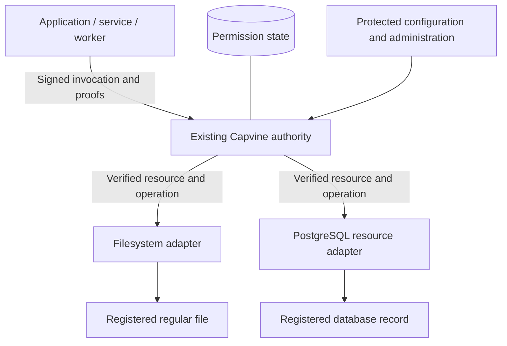

# Roadmap

Capvine is an OSS authorization library for developers who control application resource handlers and access paths. The core supports delegated permissions for services, workers, and applications; agent tools are one integration. Resource adapters connect verified requests to external APIs or application datastores. A managed service can operate the same enforcement engine later.

This is an implementation sequence, not a delivery-date commitment. The configurable resource server, filesystem/PostgreSQL adapters, and runtime integrations described below are planned features. The next milestone is tracked in [issue #3](https://github.com/farming-labs/capvine/issues/3).

## 0. Runnable proof of the boundary — implemented

- [x] A TypeScript package built on ucanto.
- [x] Exact operation/resource/task/service binding.
- [x] Recipient-bound delegation with shorter lifetimes.
- [x] Server verification of serialized requests independent of client checks.
- [x] Parent/child revocation and task termination.
- [x] Memory and SQLite state with restart tests.
- [x] An offline GitHub-shaped example and adversarial authorization tests.
- [x] A bounded Node HTTP handler and client transport.
- [x] Separate authority, coordinator, and workers with a simulated credentialed provider.
- [x] Parallel reads, raw escalation attempts, independent-root revocation, and task-end checks across HTTP.

**Evidence:** `npm run check`, `npm run example`, and `npm run example:network -- --workers 3`. The network scenario is an automated test too. This establishes an application permission path, not OS isolation or production readiness.

## 1. Resource server with filesystem and PostgreSQL adapters

### Foundation and integration checklist

These prerequisites remain visible independently of the adapter work:

- [x] Persistent authority identity and authenticated single-owner operator administration ([issue #5](https://github.com/farming-labs/capvine/issues/5)); verified by `test/service.test.ts` and `npm run example:service`.
- [x] Transactional state schema versioning, service/owner binding, restart checks, and bounded audit inspection.
- [ ] Live read-only GitHub connector with actual provider target validation.
- [ ] MCP integration bound to a provisioned worker identity, task, and grants.
- [ ] Deployment checks that establish credential and network isolation from untrusted workers.
- [ ] API review with adopters and a supported release/version policy.
- [ ] Independent security review and explicit publication approval.
- [ ] npm trusted publishing and release automation.

The first two items provide a local service foundation, not production readiness. Built-in resource adapters and a configuration-file application are still pending. External review and publication gates cannot be satisfied by internal test results.

Build one server that reads a registered text file and a registered PostgreSQL record through the same `client.invoke(grant)` flow. Reuse the authority, capability profile, resource registry, HTTP transport, and lifecycle checks. No agent runtime is required. Keep `task` as the existing authorization context for a job or workflow.

Deliver the layers in focused PRs, with detailed work items in [issue #3](https://github.com/farming-labs/capvine/issues/3):

| Layer                                  | Required work                                                                                                                                                                                                                                                                      | Completion evidence                                                                                                                                                |
| -------------------------------------- | ---------------------------------------------------------------------------------------------------------------------------------------------------------------------------------------------------------------------------------------------------------------------------------- | ------------------------------------------------------------------------------------------------------------------------------------------------------------------ |
| Adapter contract and resource bindings | Build on `registerOperation` and `execute(resource)`. Validate adapter configuration, supported kinds/actions, target bindings, and protected connection references. Define initialization and cleanup.                                                                            | Invalid configuration, duplicate registration, and wrong-kind dispatch fail closed; proof verification remains before adapter execution.                           |
| Filesystem resource adapter            | Read bounded UTF-8 content from explicitly registered regular files. Define platform and file-identity semantics and confinement against traversal, links, and replacement races.                                                                                                  | Real filesystem tests cover allowed reads, unregistered targets, link/path escapes, replacement behavior, unsupported file types, and size limits.                 |
| PostgreSQL resource adapter            | Use a protected pool and restricted database role for a predefined parameterized read, with fixed record/tenant binding and result projection. Bound results and execution time.                                                                                                   | Tests against a real ephemeral database establish the actual queried record and reject cross-record, cross-tenant, cross-connection, and write attempts.           |
| Server composition and administration  | Add validated startup/configuration, persistent authority identity and state, adapter initialization, the existing invocation route, and graceful shutdown. Keep local bootstrap administration separate; authenticate and authorize any remote administration before enabling it. | Restart retains revocations and task state; clients cannot mint root grants, retarget resources, or obtain protected credentials through the invocation interface. |
| Combined example and deployment guide  | Run ordinary clients against both adapters through one authority, with temporary file fixtures and ephemeral PostgreSQL. Document secret custody, supported limits, deployment isolation, and adapter responsibilities.                                                            | CI exercises both real resources, delegation, independent grants, revocation, task end, and restart.                                                               |

**Storage distinction:** SQLite can continue storing Capvine's grants, resources, tasks, revocations, and audit events. PostgreSQL as a protected application resource is independent of PostgreSQL as a future permission-state backend; the latter is not required for this milestone.

**Exit criteria:** the same client API reads both resources with separate grants. Changes to resource/action/task/identity, invalid proofs, expiry, and revocation reject before resource-handler execution. Adapter tests also verify the actual file opened and database record queried; a successful proof check alone is insufficient. The authority identity and lifecycle state survive restart without resetting permissions.

**Scope:** exact read operations with bounded JSON-compatible results. Directory trees, wildcards, caller-selected paths, arbitrary SQL, writes, binary streaming, native database authorization extensions, and OS sandboxing need separate designs. The adapter contract does not replace server verification or database/OS access controls.

## 2. External-service connectors and application integrations

Extend the resource server with a live read-only external API connector, initially the existing GitHub issue example. Select the connection and stable provider object identity through trusted administration. Validate the actual target where API routes use mutable names and keep upstream credentials narrowly scoped.

Integrate with application workflows and background jobs, then extract reusable runtime adapters from demonstrated lifecycle needs. Existing roles or ACLs may inform grant issuance. Optional agent-tool and MCP adapters use the same verifier rather than creating another permission path.

**Deliverables:** authenticated account/resource setup, client identity provisioning, serialized grant assignment, workflow binding, child delegation, and verification on new calls after resume/retry. MCP sessions require authenticated worker/task bindings rather than model-supplied names.

**Exit criteria:** a real application workflow succeeds; nested calls cannot expand authority; jobs cannot reuse another job's authenticated session; revoked grants fail after workflow restart; direct and adapted calls enforce the same rules. Document upstream permissions, target validation, and service limits.

## 3. An OSS release with a supported deployment

Review API ergonomics with application developers, specify the supported ucanto format/version, add schema migrations, and define identity backup/rotation and grant invalidation. Improve audit inspection without logging secrets or resource contents by default. Define and test storage failure behavior.

**Deliverables:** stable package surface, deployment guide, authenticated administration example, storage lifecycle, operational limits, dependency/update policy, and narrowly scoped npm trusted publishing.

**Exit criteria:** independent security review of the profile, verifier integration, and stated deployment boundary; integration/failure tests in that deployment; explicit maintainer approval for publication. The source remains public and MIT licensed while the package is private.

## 4. Scale and broader authority — separate designs

For multiple authority replicas, introduce an async storage contract and shared durable implementation with explicit consistency for revocations/tasks. Add tenant separation, per-principal rate limits, load measurements, and fault tests. The SQLite demo is not a horizontally scalable service.

For writes, bind authorization to exact parameters and implement replay handling, atomic consumption or budgets, concurrency control, and provider idempotency/reconciliation. A timeout must not cause a duplicate side effect. Signatures alone do not provide transaction semantics.

Resource groups, wildcard attenuation, multi-parent grants, budget splitting, and a full delegation explorer need separate semantics and tests. Offline child grants are not currently exhaustively indexed.

**Exit criteria:** each feature's invariants hold under concurrency, retries, storage failures, and revocation races. High-stakes actions are a new supported scope, not a toggle on the read example.

## 5. Optional managed offering

Operate the same OSS verifier with hosted storage, tenant provisioning, identity custody, administration, audit search, monitoring, upgrades, and availability commitments. Managed operations must not become the only place permission enforcement works.

**Exit criteria:** demand from OSS adopters, a supported production boundary, tested tenant isolation/recovery, and clear ownership of keys, data export, and incident response.

## Recommended next milestone

Complete phase 1: **one server, one registered-file reader, and one registered PostgreSQL-record reader**, tracked in [issue #3](https://github.com/farming-labs/capvine/issues/3). This validates the same permission path across two different resource types before broadening the capability profile or adding provider-specific authentication and runtime adapters.
