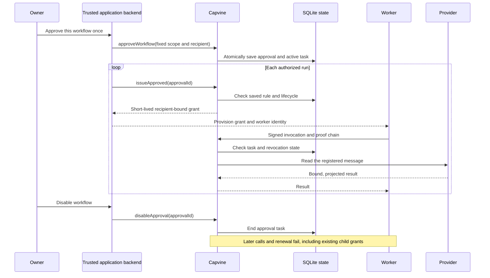

# Saved workflow approvals

Approve a fixed workflow once, then let trusted application code request short-lived grants from that saved rule. Each invocation still passes Capvine's existing proof and lifecycle checks. This works with any registered operation, including the direct Gmail reader, filesystem reads, and PostgreSQL record reads.

An approval fixes one recipient identity, one resource, one action, a finite approval expiry, and a maximum grant lifetime of 1–3600 seconds. It cannot be edited or re-enabled: use a new approval ID for a changed decision.

## Three separate decisions

| Decision                                   | Responsible component                                    | When it happens                                                                                    |
| ------------------------------------------ | -------------------------------------------------------- | -------------------------------------------------------------------------------------------------- |
| Connect a provider account                 | The direct account manager                               | Initial connection, then again if the provider requires reconnection or additional consent         |
| Allow a client to read a registered object | Your owner-facing application and Capvine administration | Once for this saved approval; again for a different scope, recipient, or expired/disabled approval |
| Issue a grant and verify an invocation     | Trusted application backend and Capvine                  | The backend requests a grant when needed; the server verifies every call                           |

Provider token renewal belongs to the account manager and is distinct from renewing a Capvine grant. The provider may require consent again. The example exercises code exchange, refresh rotation, and persistence against a local provider fixture; live Google consent/refresh still needs validation.



## Programmatic integration

This code runs in protected application code with an authenticated owner. `service`, `operatorSecret`, and `coordinatorIdentity` come from trusted provisioning; the worker must not receive the operator token.

After the owner authorizes this exact workflow:

```ts
import { createAdministrationClient } from "@farming-labs/capvine/administration";

const admin = createAdministrationClient({
  url: service.administrationUrl,
  token: operatorSecret,
});

await admin.approveWorkflow({
  id: "daily-report",
  audience: coordinatorIdentity,
  resource: "urn:capvine:resource:selected-message",
  action: "gmail/message.read",
  expiresAt: new Date(Date.now() + 30 * 24 * 60 * 60_000),
  maxGrantSeconds: 600,
});
```

On each run, the trusted backend can request a fresh grant automatically:

```ts
const grant = await admin.issueApproved("daily-report");
```

An owner can inspect or disable the workflow later:

```ts
const approval = await admin.readApproval("daily-report");
await admin.disableApproval("daily-report");
```

Application code schedules runs and delivers each grant. This API does not install a scheduler, watch token expiry, or present an approval screen.

`issueApproved` takes only the saved ID. Its authenticated HTTP command rejects extra fields; a caller cannot change the recipient, action, resource, expiry, or task through renewal. The ID itself is not authority: renewal still requires operator authentication. The backend must select the saved approval through its own authorized workflow mapping, not blindly expose its broad operator token or accept arbitrary model-selected approval IDs.

Use the existing `createClient().delegate()` to assign a coordinator's grant to a newly created worker identity. The child retains the same resource, operation, task, and service and may only shorten expiry. This needs no further owner prompt. Start a fresh delegation from a renewed parent when needed; an expired child is not refreshed in place. A different resource requires another approval or another explicitly authorized root grant.

For an embedded authority, import `createWorkflowApprovals` from `./approvals` and pass `{ authority, store, owner }`. Its `approve`, `read`, `issue`, and `disable` methods have the same semantics; the embedding application authenticates callers. Both built-in stores implement the optional `ApprovalStore` contract. Existing custom `StateStore` implementations need no changes unless they opt into saved approvals.

## Storage and enforcement

SQLite stores immutable approval records in the existing schema-1 records table. Approval creation inserts the record and its new active task atomically, rejecting duplicate IDs and task collisions. Approval state, root grants, revocations, and the authority identity survive service restart. The approval contains identifiers and policy, not provider credentials or signing keys.

Every grant uses the approval's dedicated task (`approval:<id>`). Disabling ends that task, so existing server-side lifecycle checks reject all dependent roots and offline child grants without enumerating descendants. Grant expiry cannot exceed approval expiry. Issuance still checks current resource configuration, registered operation, ownership, and the authority's issuance policy; a stored approval cannot bypass those checks.

Concurrent issuance may fail or produce a grant that is already unusable when disable takes effect. No call authorized after the task ends can dispatch through that task. Disabling does not cancel an operation already dispatched or erase data already returned. Failed storage operations do not silently succeed; callers must handle an unsuccessful disable as an error.

The operator API remains broadly privileged for one configured owner. It can create different approvals and issue other grants; saved rules do not constrain someone who holds that operator credential. The audit API records invocation outcomes, not a complete history of administrative changes. State is private local SQLite, not encrypted or tamper-evident storage. Back up and restore with the [service constraints](service.md).

## Evidence and scope

`test/approvals.test.ts` covers exact bindings, raw signed escalation requests, expiry, child invalidation, owner boundaries, storage failure, atomic creation, and issuance racing with disable. `test/service.test.ts` covers authenticated commands, field substitution, resource removal, persistence, and disable across restart.

Run the [direct account demonstration](accounts.md) for an OAuth/OIDC provider fixture, persistent credential and authorization stores, and a separate worker process. It demonstrates code exchange, refresh, one approval reused after restart, account identity substitution rejection, and disabling existing grants. Live Google consent/refresh, an owner approval UI, arbitrary Gmail selection, writes, and production isolation remain outside this milestone.
