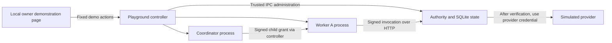

# Delegation playground

An interactive, local walkthrough of the real Capvine verifier. It uses temporary fixture data and no connected account, model API key, or external service.

```sh
npm ci
npm run playground
```

Open **http://127.0.0.1:8788/**. Node.js 24 or later is required. The account console can run separately on port 8787.

## Try it

1. **Approve issue 42.** The owner grants the coordinator permission to read one registered issue for ten minutes. This does not read the issue.
2. **Delegate to Worker A.** The coordinator signs a child grant for Worker A with the same scope and a lifetime of at most five minutes. Another owner approval is not needed.
3. **Read issue 42.** The worker signs a request, the server validates it, and the simulated provider returns the selected issue. Repeat the read: the grant permits repeatable reads, not one-time execution.
4. While the grant is active, try **Read issue 43**, **Post a comment**, **Try as Worker B**, and **Send expired request**. These bypass the client helper's validation and send raw signed invocations to the real HTTP verifier. Each should be denied, with no additional successful provider read.
5. **Bypass Capvine** calls the fixture provider without its credential. The provider should return HTTP 401. This verifies that the demo worker was not provisioned with the provider credential; it does not establish network containment.
6. **Revoke parent**, then **Read issue 42** again. The child's next call should be denied. Reset and repeat with **End task** to test task termination independently.

The result panel shows actual server audit decisions, successful provider-read deltas, and fixture responses. Unexpected results are marked as failures. Grant IDs, public worker identities, and process IDs can be inspected. Private signing keys, encoded grants, and provider credentials are not returned to the browser.

Reset creates new identities, empty state, and new child processes. Stop with Ctrl+C. Graceful shutdown and reset remove the temporary SQLite directory. An abrupt kill can leave a temporary fixture directory. The example permits at most 100 actions before reset.

## What runs where



The browser controls a fixed scenario. It does not choose resource IDs, arbitrary URLs, signing keys, or provider credentials. The controller reuses the [network example](../network/README.md): an authority, coordinator, and two workers in separate Node processes. The authority and simulated provider share one process. No language model is needed to exercise authorization.

This page is an owner test driver, not an interface to expose to an untrusted worker. It has no owner login because it operates only on disposable fixture data. It binds to `127.0.0.1`, validates Host and Origin, requires a random page token for POSTs, and rejects arbitrary commands. These browser protections do not authenticate other local processes. Do not forward this port, connect real credentials to the fixture, or deploy it as a production approval service.

## Turning the workflow into an application

Use an authenticated owner UI or a saved approval to select exact registered resources and actions. Protected backend code issues a parent grant to an authenticated coordinator identity. A coordinator can delegate within that scope to separately provisioned worker identities. Workers call the existing HTTP or MCP integration. The resource server verifies the call and only then selects the registered adapter and protected account connection.

The [workflow approval API](../../docs/workflow-approvals.md), [resource adapters](../../docs/resources.md), [MCP bridge](../../docs/connectors.md), and [account manager](../../docs/accounts.md) provide those backend pieces. The [account console](../../docs/account-console.md) manages connections; it does not yet provide production resource selection, workflow approval, or a general delegation explorer. This fixture UI does not close those roadmap items.

## What this does not prove

Separate processes under the same OS account are not a sandbox. The demo does not test containment of arbitrary shell commands, logged-in browsers, key theft, or alternate account access. Real deployments must protect keys and state and close those bypass paths. An authorized reader can disclose returned data. Revocation blocks subsequent checks, not an operation already dispatched. Expiry tests an expired invocation, not a five-minute wall-clock wait. There are no authorized writes, budgets, or one-time transactions in this example.

Automated coverage: `test/playground.test.ts` drives the browser API through the real child processes and checks that denied signed requests produce server denials without provider reads. `npm run example:network -- --workers 3` additionally checks task substitution, independent grants, and multi-worker fan-out. These tests provide evidence for specific boundaries, not a guarantee of zero security risk.
