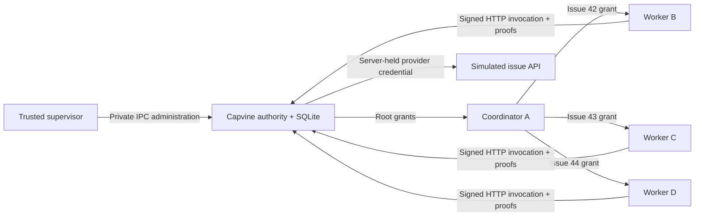

# Delegation across separate processes

Run from the repository root with Node.js 24 or later:

```sh
npm ci
npm run example:network -- --workers 3
```

No model key, GitHub account, Docker installation, or cloud service is required. The program starts loopback servers and a temporary SQLite database, checks the results, then cleans up. A failed assertion exits with an error.

This is real HTTP communication between separate processes with a **simulated provider**. It is not a deployment sandbox: all processes run under the same OS user. Unrestricted access to that user's files or other processes could bypass these application boundaries.

## What happens



1. The authority and each worker generate different identity keys inside their own processes. Only public identities and proof archives travel between them.
2. The supervisor asks the authority to issue one exact read grant per selected issue to A. The demo owner policy is fixed local code; this is not an owner login implementation.
3. A delegates each grant to a different worker, shortening its lifetime. No additional owner approval is needed.
4. The workers read concurrently over HTTP, each presenting its own signature and complete proof chain.
5. Worker B bypasses SDK helpers and signs requests for another issue, another operation, and another existing task. The authority rejects all three before executing a handler.
6. A direct provider request without the provider credential gets `401`. The invocation server has no administration endpoints.
7. Revoking B's root grant disables B's chain. C and D still work because their grants have independent roots.
8. Ending the task disables every remaining grant for that task.

The output includes:

```text
ALLOW worker 1: read issue 42
ALLOW worker 2: read issue 43
ALLOW worker 3: read issue 44
DENY worker 1: read another issue
DENY worker 1: post a comment
DENY worker 1: switch task
DENY direct provider access: worker has no provider credential
DENY HTTP administration: no owner endpoints are exposed to workers
DENY worker 1 after revoking its parent grant
ALLOW worker 2: its independent grant still works
ALLOW worker 3: its independent grant still works
DENY all workers after the task ends
Verified 5 authorized provider reads; rejected capability calls never reached the provider.
```

Try `--workers 8` to fan out to eight workers. The fixture supports 1–8 workers; this is not a throughput benchmark or a limit on how many agents the permission model can represent. Each worker still carries two grants: authority → coordinator → worker. More workers do not require a deeper chain.

## Files to follow

| File                             | Responsibility                                                                                               |
| -------------------------------- | ------------------------------------------------------------------------------------------------------------ |
| [demo.ts](demo.ts)               | Starts processes, provisions assignments, checks results, revokes grants, and ends the task.                 |
| [authority.ts](authority.ts)     | Owns SQLite, signing identity, owner policy, verified dispatch, provider credential, and simulated provider. |
| [worker.ts](worker.ts)           | Creates a worker identity, delegates, and invokes through HTTP; also constructs raw escalation attempts.     |
| [ipc.ts](ipc.ts)                 | Example-only supervisor control channel and process lifecycle, not a public administration API.              |
| [src/http.ts](../../src/http.ts) | Reusable bounded HTTP handler and client transport.                                                          |

The supervisor is trusted orchestration. Workers are not given the authority's database path or signing key. OS permissions and deployment isolation must enforce that separation in a real installation. Preserve the database and authority identity together for a long-running service; the demo deliberately discards both.

Continue with the [integration guide](../../docs/integration.md) and [roadmap](../../docs/roadmap.md).
